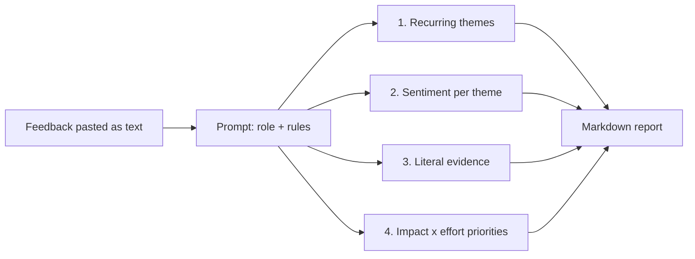

# prompt-analise-feedbacks-bancarios-dio

**English** · [Português (Brasil)](README.md)

  

## What it is

A structured prompt for analysing bank customer feedback and turning loose text into a short CX report: recurring themes, sentiment per theme, quoted evidence and a prioritised action list. This is a documentation repository — there is no code, script or dependency; the deliverable is the prompt and the method for using it.

## Status

Complete as a text artefact. The prompt is published in this README and can be copied straight into any AI assistant. There is no automated pipeline and no sample data committed.

## Features

- **Fixed output structure**: executive summary, themes with volume and sentiment, literal evidence and priorities.
- **Theme and sentiment classification**: each feedback item gets a theme, a polarity and an urgency.
- **Traceability**: every conclusion quotes the feedback excerpt that supports it.
- **Impact × effort prioritisation**: the final list is ordered by what matters, not by order of appearance.
- **Guardrails**: the prompt forbids inventing numbers, forbids generalising from a single case and requires flagging what the material does not contain.
- **Tolerant input**: app store reviews, NPS surveys, e-mail, chat transcripts or a spreadsheet pasted as text.

## Architecture

The prompt has four blocks applied in order: role and objective, analysis rules, output format and prioritisation criteria. The output is a Markdown report with five fixed sections.



The prompt, ready to use:

```text
You are a customer experience (CX) analyst at a digital bank.
You will receive a set of customer feedback items as raw text.

Rules:
1. Work only with the text provided. Do not invent numbers, causes or
   segments that do not appear in the material.
2. If the sample is small or biased, say so at the start.
3. Do not generalise a single case into a pattern.
4. Quote the literal excerpt that supports each conclusion, in quotes.
5. Separate complaints, praise and suggestions.

Deliver in Markdown, in this order:
- Executive summary (up to 5 lines).
- Recurring themes: theme, number of mentions, predominant sentiment.
- Evidence: 1 to 3 excerpts per theme.
- Priorities: table with action, impact (high/medium/low),
  effort (high/medium/low) and why now.
- Gaps: what the material does not allow concluding.

Feedback:
"""
<paste here>
"""
```

## Stack

- Markdown (the artefact format)
- Any AI assistant with enough context window for the feedback batch

## Repository structure

```
prompt-analise-feedbacks-bancarios-dio/
├── README.md      # Portuguese version
├── README.en.md   # prompt + usage method (this file)
└── LICENSE        # MIT
```

## Prerequisites and installation

None. Open the README and copy the prompt block.

## How to run

1. Gather the feedback as plain text, one item per line or separated by blank lines.
2. Copy the prompt block from the Architecture section.
3. Paste the feedback where `<paste here>` is.
4. Send it to the assistant and read the output in the five-section order.
5. For large volumes, split into batches by channel or period and consolidate the themes afterwards.

## Tests and quality

There are no automated tests. The available check is output consistency: run the same batch twice and compare themes and priorities; a large divergence means the prompt needs fixed examples (few-shot) or an explicit sentiment scale.

## Technical decisions and trade-offs

- **Prompt instead of a pipeline**: no code required, runs in any assistant and is easy to review; in exchange, results vary between models and runs.
- **Mandatory evidence**: reduces hallucination and makes checking easy; in exchange, the output gets longer.
- **Impact × effort prioritisation**: actionable for product and support; in exchange, it relies on judgement rather than quantitative data.
- **No numeric sentiment scale**: positive/negative/neutral is more stable across models; a 1-to-5 scale varies more.
- **No sample data committed**: avoids publishing real customer feedback; in exchange, newcomers cannot test without building their own batch.

## Known limitations and roadmap

- Quality depends on the model and batch size; very large batches lose detail.
- There is no objective accuracy metric for the classification.
- Feedback with irony or very informal Portuguese can be misclassified.
- Roadmap: publish a synthetic sample batch, a few-shot version with labelled cases and a spreadsheet to track the prioritised actions.

## Development process

An individual project by Kelvin Oliveira for a DIO challenge, written and reviewed by the author with AI agents.

## License and author

[MIT](LICENSE).

**Author**: [Kelvin Oliveira](https://github.com/KelvinOliveiraCode) · [Portfolio](https://kelvinoliveiracode.github.io/portfolio/)
