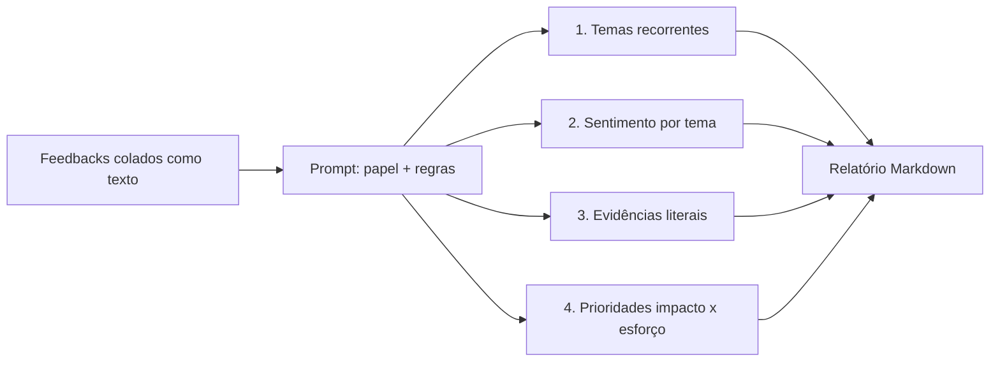

# prompt-analise-feedbacks-bancarios-dio

[English](README.en.md) · **Português (Brasil)**

  

## O que é

Um prompt estruturado para analisar feedbacks de clientes bancários e transformar texto solto em um relatório curto de CX: temas recorrentes, sentimento por tema, evidências citadas e uma lista priorizada de ações. O repositório é de documentação — não há código, script ou dependência; o entregável é o prompt e o método de uso.

## Status

Concluído como artefato de texto. O prompt está publicado neste README e pode ser copiado direto para qualquer assistente de IA. Não há pipeline automatizado nem dados de exemplo versionados.

## Funcionalidades

- **Estrutura de saída fixa**: resumo executivo, temas com volume e sentimento, evidências literais e prioridades.
- **Classificação por tema e sentimento**: cada feedback recebe tema, polaridade e urgência.
- **Rastreabilidade**: toda conclusão cita o trecho do feedback que a sustenta.
- **Priorização por impacto × esforço**: a lista final sai ordenada, não em ordem de aparição.
- **Guardrails**: o prompt proíbe inventar números, proíbe generalizar a partir de um caso único e exige marcar o que não está no material.
- **Formato de entrada tolerante**: comentários de app store, pesquisa NPS, e-mail, chat ou planilha colada como texto.

## Arquitetura

O prompt é dividido em quatro blocos, aplicados nesta ordem: papel e objetivo, regras de análise, formato de saída e critérios de priorização. A saída é um relatório em Markdown com cinco seções fixas.



O prompt, pronto para uso:

```text
Você é analista de experiência do cliente (CX) de um banco digital.
Receberá um conjunto de feedbacks de clientes como texto bruto.

Regras:
1. Trabalhe apenas com o texto recebido. Não invente números, causas ou
   segmentos que não apareçam no material.
2. Se a amostra for pequena ou enviesada, diga isso no início.
3. Não generalize um caso isolado como padrão.
4. Cite o trecho literal que sustenta cada conclusão, entre aspas.
5. Separe o que é reclamação, elogio e sugestão.

Entregue em Markdown, nesta ordem:
- Resumo executivo (até 5 linhas).
- Temas recorrentes: tema, nº de menções, sentimento predominante.
- Evidências: 1 a 3 trechos por tema.
- Prioridades: tabela com ação, impacto (alto/médio/baixo),
  esforço (alto/médio/baixo) e por que agora.
- Lacunas: o que o material não permite concluir.

Feedbacks:
"""
<cole aqui>
"""
```

## Stack

- Markdown (formato do artefato)
- Qualquer assistente de IA com janela de contexto suficiente para o lote de feedbacks

## Estrutura do repositório

```
prompt-analise-feedbacks-bancarios-dio/
├── README.md      # prompt + método de uso (pt-BR)
├── README.en.md   # versão em inglês
└── LICENSE        # MIT
```

## Pré-requisitos e instalação

Nenhum. Basta abrir o README e copiar o bloco de prompt.

## Como executar

1. Reúna os feedbacks em texto puro, um por linha ou separados por linha em branco.
2. Copie o bloco de prompt da seção Arquitetura.
3. Cole os feedbacks no lugar de `<cole aqui>`.
4. Envie ao assistente e leia a saída na ordem das cinco seções.
5. Se o volume for grande, divida em lotes por canal ou por período e consolide os temas depois.

## Testes e qualidade

Não há testes automatizados. A checagem possível é de consistência da saída: rodar o mesmo lote duas vezes e comparar temas e prioridades; divergência grande indica que o prompt precisa de exemplos fixos (few-shot) ou de uma escala de sentimento explícita.

## Decisões técnicas e trade-offs

- **Prompt em vez de pipeline**: não exige código, roda em qualquer assistente e é fácil de revisar; em troca, o resultado varia entre modelos e execuções.
- **Evidência obrigatória**: reduz alucinação e facilita conferência; em troca, deixa a saída mais longa.
- **Priorização por impacto × esforço**: é acionável para produto e suporte; em troca, depende de julgamento e não de dados quantitativos.
- **Sem escala numérica de sentimento**: positivo/negativo/neutro é estável entre modelos; uma escala de 1 a 5 varia mais.
- **Sem dados de exemplo versionados**: evita publicar feedback real de cliente; em troca, quem chega ao repositório não consegue testar sem montar o próprio lote.

## Limitações conhecidas e roadmap

- A qualidade depende do modelo usado e do tamanho do lote; lotes muito grandes perdem detalhe.
- Não há métrica objetiva de acurácia da classificação.
- Feedbacks com ironia ou português muito informal podem ser mal classificados.
- Roadmap: publicar um lote sintético de exemplo, uma versão few-shot com casos rotulados e uma planilha de acompanhamento das ações priorizadas.

## Processo de desenvolvimento

Projeto individual de Kelvin Oliveira para um desafio da DIO, escrito e revisado pelo autor com apoio de agentes de IA.

## Licença e autor

[MIT](LICENSE).

**Autor**: [Kelvin Oliveira](https://github.com/KelvinOliveiraCode) · [Portfólio](https://kelvinoliveiracode.github.io/portfolio/)
